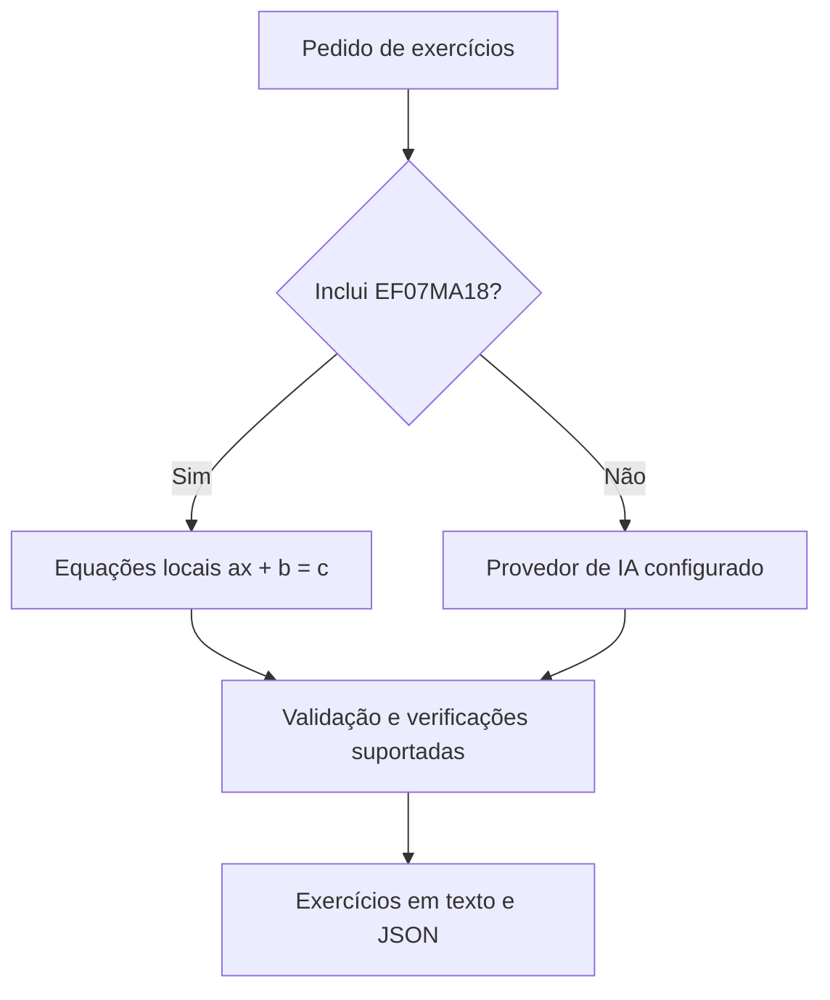

# GeradorIaExercicios

**Exercícios de matemática com enunciado, resposta e explicação, prontos para consultar ou integrar a uma aplicação.**


[](LICENSE)


O GeradorIaExercicios combina geração com inteligência artificial e um gerador local de equações. Você escolhe o tópico, a quantidade e as dificuldades; recebe exercícios em texto e JSON, com validação de estrutura e verificações matemáticas para formas suportadas.

É um projeto aberto para experimentar geração de conteúdo educacional, criar listas de estudo e conectar esse fluxo a outras ferramentas.

[Experimentar sem chave](#experimente-sem-chave-de-api) · [Usar IA](#geração-com-ia) · [Abrir a interface](#interface-no-navegador) · [Integrar em Python](#integração-em-python)

## O que você pode fazer

- Gerar lotes de 1 a 40 exercícios com resposta e explicação.
- Escolher um nível ou combinar exercícios fáceis, médios e difíceis.
- Usar OpenAI, Google Gemini ou xAI Grok com suas próprias chaves.
- Informar códigos de habilidades de matemática da BNCC pela CLI ou biblioteca.
- Experimentar equações `ax + b = c` localmente, sem chamadas de IA.
- Visualizar exercícios e JSON na interface local, além dos registros de uso disponíveis.
- Reutilizar o gerador em uma aplicação Python.

## Comece aqui

Você precisa de **Python 3.11 ou superior** e Git. Na raiz do projeto, crie um ambiente virtual e instale o pacote:

**Linux / macOS — Bash**

```bash
git clone https://github.com/VirgilioFuchs/GeradorIaExercicios.git
cd GeradorIaExercicios
python3 -m venv .venv
source .venv/bin/activate
python -m pip install -e .
```

**Windows — PowerShell**

```powershell
git clone https://github.com/VirgilioFuchs/GeradorIaExercicios.git
cd GeradorIaExercicios
py -3 -m venv .venv
.\.venv\Scripts\Activate.ps1
python -m pip install -e .
```

Se o PowerShell bloquear a ativação, execute os comandos com `.\.venv\Scripts\python.exe` no lugar de `python`.

## Experimente sem chave de API

Este comando gera **uma equação do primeiro grau**, com a habilidade `EF07MA18`, sem acessar serviços externos:

```bash
python -m exercise_ai.main --habilidade-bncc EF07MA18 --quantidade 1 --out exemplo.json
```

Saída real no terminal:

```text
### Exercício 1
Enunciado: 2x + 1 = 3
Resposta: 1
Explicação: Subtraia 1 dos dois lados: 2x = 2. Divida por 2: x = 1.
```

O arquivo é salvo em `exercise_ai/exercicios-gerados/success/exemplo.json`:

```json
{
  "exercicios": [
    {
      "enunciado": "2x + 1 = 3",
      "resposta": "1",
      "explicacao": "Subtraia 1 dos dois lados: 2x = 2. Divida por 2: x = 1.",
      "dificuldade": "facil"
    }
  ],
  "dificuldades": ["facil"],
  "habilidades_bncc": ["EF07MA18"],
  "template_id": "ax_plus_b_eq_c",
  "version": "1"
}
```

A geração local é **determinística**: começa pela mesma sequência de parâmetros a cada pedido. Repetir a quantidade e a configuração reproduz os mesmos itens. Os níveis são etiquetas solicitadas, sem calibração pedagógica automática.

O caminho local atende à família `ax + b = c` quando o pedido inclui `EF07MA18`; não é um gerador offline de todos os tópicos. Use essa habilidade para experimentar equações dessa família: o tópico escrito não seleciona outras famílias.

## Geração com IA

Para outros pedidos, configure a chave do provedor que deseja usar. Copie `exercise_ai/.env.example` para `.env` na raiz:

```bash
# Linux / macOS
cp exercise_ai/.env.example .env
```

```powershell
# Windows
Copy-Item exercise_ai/.env.example .env
```

Edite o arquivo e preencha a chave correspondente:

| Provedor | Variável da chave | Valor de `LLM_PROVIDER` |
| --- | --- | --- |
| OpenAI | `LLM_API_KEY` | `openai` |
| Google Gemini | `GEMINI_API_KEY` | `gemini` |
| xAI Grok | `GROK_API_KEY` | `grok` |

Exemplo de configuração para OpenAI:

```dotenv
LLM_PROVIDER=openai
LLM_API_KEY=sua_chave_aqui
```

As chamadas de IA usam sua conta no provedor e podem gerar cobrança. Não publique `.env`, chaves ou registros privados; antes de fazer commits, confira os arquivos selecionados.

Com a chave configurada:

```bash
python -m exercise_ai.main --topico "Equação do primeiro grau" --dificuldade facil --quantidade 3 --provider openai --out exercicios.json
```

Prefere responder perguntas no terminal? Abra o assistente interativo:

```bash
python -m exercise_ai.main gerar
```

Para um lote misto, `--plano 2,3,1` solicita dois exercícios fáceis, três médios e um difícil:

```bash
python -m exercise_ai.main --topico "Equação do primeiro grau" --plano 2,3,1 --out lote-misto.json
```

Use `python -m exercise_ai.main --help` para consultar todas as opções, incluindo BNCC, provedor e tentativas de regeneração. `--out` é obrigatório na geração por flags; um caminho absoluto salva o JSON exatamente no local indicado.

## Interface no navegador

Com o pacote instalado e uma chave configurada, execute:

```bash
python demo/serve.py
```

Abra **[http://[::1]:8642/](http://[::1]:8642/)**. Na interface, escolha tópico, quantidade, distribuição de dificuldades, provedor e modelo; depois consulte os exercícios, o JSON e a aba de uso.

A interface usa geração com IA e não oferece campo BNCC; para o exemplo offline, use a CLI acima. Os modelos exibidos vêm do catálogo local, e a disponibilidade depende da conta e do provedor.

O servidor funciona apenas no seu computador, pelo endereço IPv6 `[::1]`, com uma geração por vez. Se IPv6 estiver desabilitado, a interface não inicia; a CLI continua sendo uma alternativa. Veja os detalhes em [demo/README.md](demo/README.md).

## Como funciona



O projeto valida campos, quantidade e estrutura dos resultados. As verificações matemáticas cobrem formas reconhecidas, como operações aritméticas e algumas equações do primeiro grau; **não garantem correção de qualquer problema ou explicação**.

Os códigos BNCC são conferidos contra o catálogo de matemática incluído no pacote. Aceitar um código e registrá-lo no JSON **não comprova alinhamento pedagógico**. Revise o conteúdo antes de usá-lo em aulas ou avaliações.

## Integração em Python

A biblioteca permite obter o lote diretamente, sem depender da CLI. Este exemplo também funciona sem chave:

```python
from exercise_ai.models import DificuldadeEnum, GenerationRequest
from exercise_ai.service import generate_batch

pedido = GenerationRequest(
    materia="Matemática",
    topico="Equação do primeiro grau",
    dificuldade=DificuldadeEnum.FACIL,
    quantidade=3,
    habilidade_bncc=["EF07MA18"],
)
lote = generate_batch(pedido)
print(lote.model_dump_json(indent=2, exclude_none=True))
```

Para geração geral com IA, carregue seu `.env` com `dotenv.load_dotenv()` antes da chamada ou defina as variáveis no ambiente. Faça uma geração por vez em cada processo.

## Contribua

Sugestões, relatos de problemas e melhorias são bem-vindos nas [Issues](https://github.com/VirgilioFuchs/GeradorIaExercicios/issues). Ao relatar um problema, informe os parâmetros usados e o resultado esperado, removendo dados privados.

Para executar os testes locais, sem chamadas reais às APIs:

```bash
python -m pip install -e ".[dev]"
python -m pytest exercise_ai demo/tests -q
```

## Licença

Distribuído sob a [licença MIT](LICENSE). Você pode usar, modificar e distribuir o código, inclusive comercialmente, preservando o aviso de copyright e a licença.

Desenvolvido por [Virgílio Fuchs](https://github.com/VirgilioFuchs).
